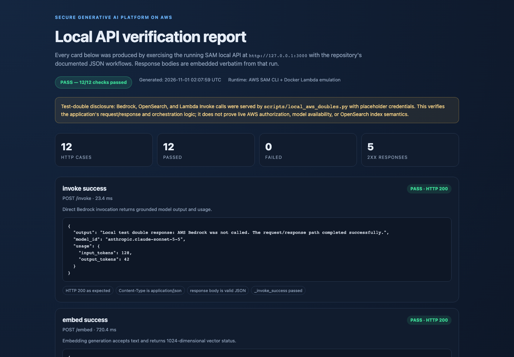
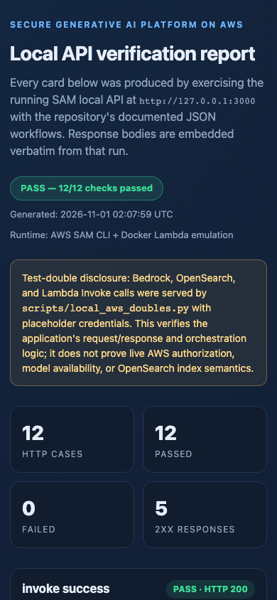
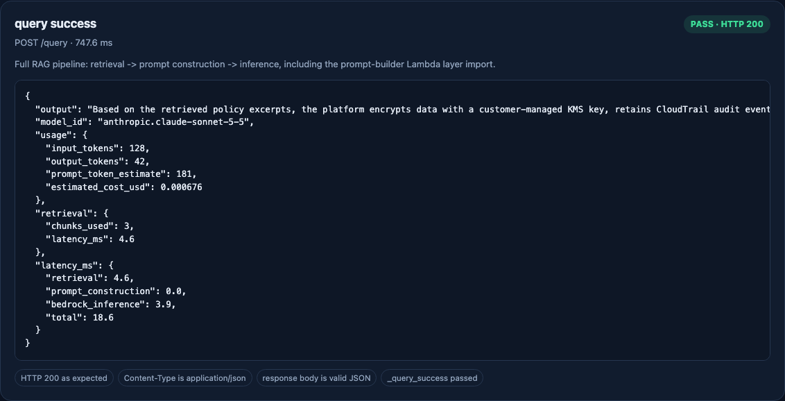
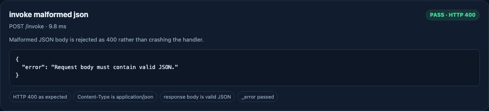
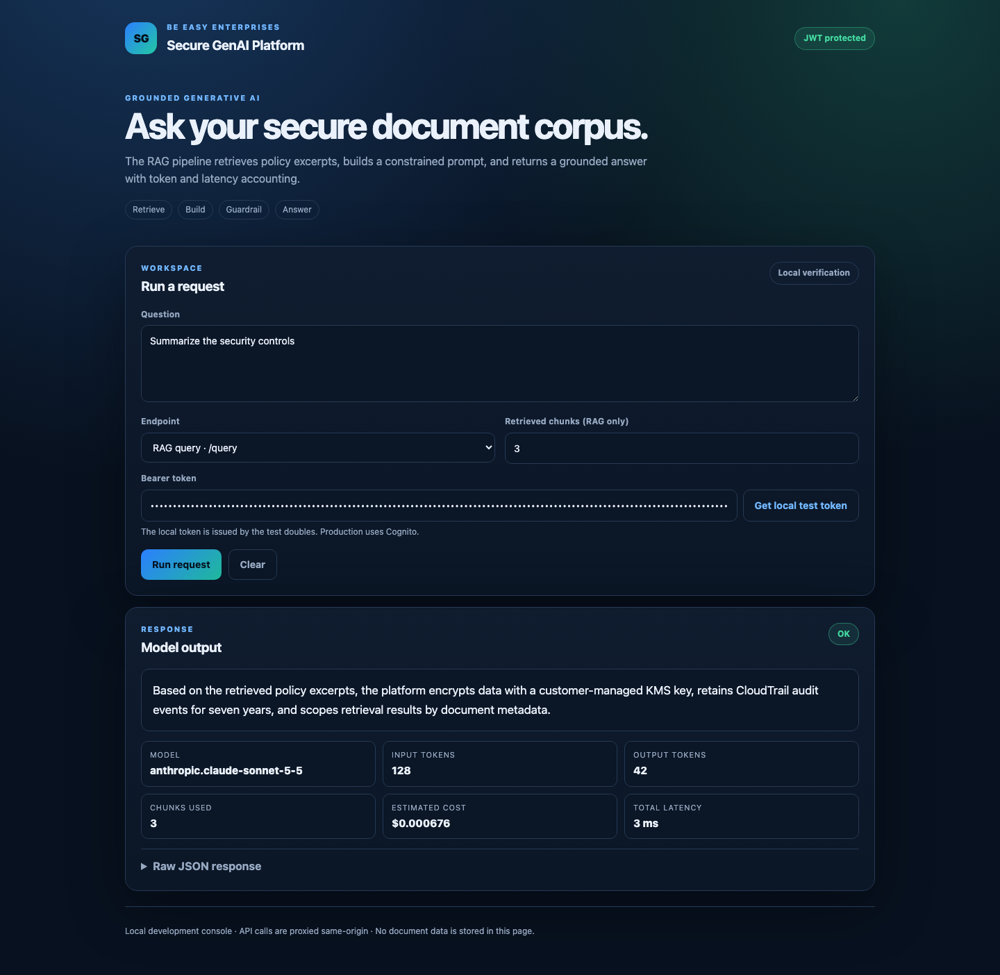
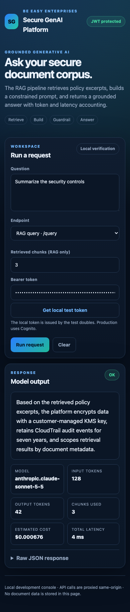

# Secure Generative AI Platform on AWS

> Reference Generative AI platform on AWS using Bedrock, RAG, and a hardened DevSecOps architecture aligned to FedRAMP High. Locally executable with AWS SAM; cloud deployment is not exercised by this repository's verification.

[](https://www.python.org/) [](https://www.terraform.io/) [](https://aws.amazon.com/bedrock/) [](FEDRAMP-ALIGNMENT.md) [](LICENSE)

> **Verification status (2026-10-31):** The SAM local API and local RAG console were executed end-to-end against deterministic local service doubles; 141 tests, 87% application coverage, mypy, Ruff, SAM build/validation, Terraform mock-provider plans, a LocalStack S3/IAM/KMS infrastructure test, authenticated HTTP E2E (12/12), and Playwright UI E2E (5/5) pass. Cognito/JWT authentication, Guardrails pass-through, optional Comprehend PII redaction, and inference-profile configuration are wired. Live AWS deployment, live model access, and unsupported-service apply behavior remain unverified. See [docs/evidence/verification-report.md](docs/evidence/verification-report.md).

---

## Overview

1. Provides a secure Generative AI reference implementation on AWS using Amazon Bedrock for LLM inference and Retrieval-Augmented Generation (RAG) for grounding responses in proprietary document corpora.
2. Provides a hardened RAG pipeline that ingests documents via S3, generates embeddings, stores vectors in OpenSearch Serverless or Aurora pgvector, and retrieves context for prompt construction with injection-mitigation controls.
3. Enforces a defense-in-depth security architecture including IAM least-privilege, KMS CMK encryption, AWS WAF, private VPC endpoints, CloudTrail audit logging, and GuardDuty threat detection.
4. Implements adversarial resilience controls mapped to STRIDE and MITRE ATT&CK, including prompt injection sanitization, retrieval metadata filtering, and token-abuse design controls. PII anonymization/blocking is delegated to Bedrock Guardrails when configured, with optional Amazon Comprehend input redaction behind a feature flag.
5. Delivers a DevSecOps pipeline design with Terraform infrastructure-as-code, SAM-based local testing, automated security scanning targets, and deployment strategy documentation.
6. Maintains a self-assessed FedRAMP High alignment of 92% (318/345 High baseline controls) across 18 of 20 NIST 800-53 Rev 5 control families. This is a mapping exercise, not an authorization; see FEDRAMP-ALIGNMENT.md.

---

## Architecture

```
  Document Sources
  ┌──────────────┐
  │  S3 Ingestion│
  │  (Raw Docs)  │
  └──────┬───────┘
         │
         ▼
  ┌──────────────┐
  │  Embedding   │  Lambda (RagEmbeddingFunction)
  │  Pipeline    │  boto3 + Bedrock Titan Embeddings
  └──────┬───────┘
         │
         ▼
  ┌──────────────────────────┐
  │  Vector Store            │
  │  OpenSearch Serverless   │
  │  (or Aurora pgvector)    │
  └──────┬───────────────────┘
         │
         ▼
  ┌──────────────┐        ┌──────────────────────┐
  │  RAG         │◄───────│  Bedrock Guardrails   │
  │  Orchestrator│        │  PII Redaction / WAF  │
  │  (Lambda)    │        └──────────────────────┘
  └──────┬───────┘
         │
         ▼
  ┌──────────────┐        ┌──────────────────────┐
  │  Bedrock LLM │        │  Prompt Builder       │
  │  (Claude /   │◄───────│  Lambda Layer         │
  │   Titan)     │        └──────────────────────┘
  └──────┬───────┘
         │
         ▼
  ┌──────────────────────────┐
  │  API Gateway + Lambda    │
  │  (BedrockOrchestratorFn) │
  └──────┬───────────────────┘
         │
         ▼
  ┌──────────────┐
  │  AWS WAF     │
  │  Cognito     │
  └──────┬───────┘
         │
         ▼
  ┌──────────────────────────────────────────────┐
  │  Observability & Governance                  │
  │  CloudTrail │ CloudWatch │ GuardDuty │ Config │
  └──────────────────────────────────────────────┘
```

---

## Key Features

### Generative AI Layer (Bedrock)

The platform integrates Amazon Bedrock as the LLM inference engine with prompt engineering patterns and response-shaping utilities.

- Claude Messages API request shaping with a generic text-completion body for other model families; explicit model routing/fallback policy is not implemented
- Prompt engineering templates for RAG, citation, and summarization modes
- Bedrock Guardrails provisioned in Terraform (including PII anonymization/blocking) and applied by handlers when `BEDROCK_GUARDRAIL_ID` / `BEDROCK_GUARDRAIL_VERSION` are configured
- Token usage and cost estimation in the response; token caps, budget alarms, and anomaly detection are deployment targets, not handler-enforced
- Output filtering/anonymization is delegated to the configured Bedrock Guardrail; no separate moderation call is made in the Lambda response path

### RAG Pipeline

The RAG pipeline supports ingestion and retrieval from document corpora and returns grounded model responses.

- S3-triggered document ingestion with a 5 MB object-size guard; checksum validation is a design target, and S3 versioning is defined in Terraform
- Embedding generation via Bedrock Titan Embeddings (Lambda: RagEmbeddingFunction)
- Vector storage in OpenSearch Serverless (Aurora pgvector is roadmap-only)
- Metadata filters are passed to OpenSearch; they are not an authorization boundary and must not be treated as tenant isolation
- Prompt construction via a reusable Lambda layer (layers/prompt_builder)
- Prompt-injection input sanitization; retrieval output validation is a design target

### Authentication and Local UI

- Cognito user pool + API Gateway authorizer in Terraform
- Handler-level JWT/JWKS validation (defense in depth)
- Local test issuer and RSA/JWKS doubles for authenticated E2E
- Dependency-free local RAG console with loading, empty, success, and error states

### Adversarial Resilience and Security

The platform includes a threat model mapped to STRIDE and MITRE ATT&CK, with hands-on attack simulation scripts for red team exercises.

| Threat                 | Mitigation                                            |
| ---------------------- | ----------------------------------------------------- |
| Prompt Injection       | Input sanitization + retrieval filtering + Guardrails |
| Data Exfiltration      | Private VPC endpoints + IAM permission boundaries     |
| Token Abuse            | Rate limiting + CloudWatch alarms + budget alerts     |
| Data Tampering         | S3 versioning + checksum validation + Object Lock     |
| Privilege Escalation   | Least-privilege IAM + IAM Access Analyzer             |
| Public Exposure        | Private API Gateway + AWS WAF rules                   |
| Retrieval Manipulation | Output validation + metadata scoping                  |

Attack simulation scripts are located in security/attack-simulation/ and cover prompt injection, token flooding, data leakage, retrieval manipulation, and IAM misconfiguration scenarios.

### DevSecOps CI/CD

The platform uses Terraform for cloud infrastructure and AWS SAM for local Lambda development and testing.

- Terraform modules for the full stack (`network`, `s3`, `iam`, `auth`, `bedrock`, `opensearch`, `rag`, `security`, `waf`, `api`), with mock-provider plans for dev/prod and a LocalStack S3/IAM/KMS apply test
- GitHub Actions CI runs tests, mypy, coverage, Ruff, pip-audit, SBOM generation, Terraform format/validate/tests, SAM validate/build, cfn-lint, and a LocalStack infrastructure job
- Deployment strategy documentation for canary/blue-green and rollback; automation is not implemented in this repository
- SAM CLI integration for local Lambda invocation and API Gateway simulation
- CI runs `pip-audit` and generates a CycloneDX SBOM; SAST and container-image scanning remain roadmap items

### Security and Compliance

- Self-assessed FedRAMP High alignment — 92% (318/345 High baseline controls, 18/20 control families), not an authorization
- NIST SP 800-53 Rev 5 High Baseline
- NIST AI Risk Management Framework 1.0 (GOVERN, MAP, MEASURE, MANAGE functions)
- AWS GovCloud variable example provided; not deployed or verified
- MITRE ATT&CK and STRIDE threat model
- SOC 2 Type II mapping (see security/compliance-mapping.md)
- AWS Well-Architected Framework Security Pillar guidance
- Zero Trust network design guidance (VPC, private subnets, endpoints); the `network` module is defined but not deployed in this audit
- CloudTrail organization-wide audit logging with S3 Object Lock (WORM, 7-year retention) is a design target; it is not instantiated by the current Terraform roots
- KMS CMK encryption is defined for S3 documents and OpenSearch Serverless; end-to-end encryption and TLS enforcement are not verified in a live account

---

## Quick Start

### Prerequisites

- Python 3.12+ for the test suite and tooling; Lambda runtime is Python 3.13
- AWS SAM CLI >= 1.100.0
- Docker Desktop (required for SAM container builds and local invocation)
- Terraform >= 1.5 (only for infrastructure commands)
- AWS CLI configured with appropriate credentials (only when calling real AWS services)
- GNU Make
- LocalStack Community Docker image (optional, for the S3/IAM/KMS infrastructure test)

> **Model access is account- and region-specific.** The default `BEDROCK_MODEL_ID` is `anthropic.claude-sonnet-5-5`. Before deploying, confirm model access in your account/region and, where required, set `BEDROCK_INFERENCE_PROFILE_ARN` (or the corresponding Terraform `inference_profile_arn`). An early live smoke test in the audit environment received `ValidationException` (on-demand throughput unsupported) and `AccessDeniedException` (model not available for the account); see the verification report.

### Local Development

Use the SAM CLI targets in the Makefile for local Lambda testing without deploying to AWS.

```bash
# Install development/test dependencies (optional; boto3 is already available
# in the Lambda runtime and most local Python environments)
python3 -m pip install -r requirements-dev.txt

# Run the full test suite and lint
make test
make lint

# Prepare the Lambda layer and build all functions
make sam-build

# Validate the SAM template
make sam-validate

# Invoke individual functions with sample events (calls real AWS services
# when the event reaches Bedrock/OpenSearch)
make sam-invoke-bedrock
make sam-invoke-ingestion
make sam-invoke-embedding
make sam-invoke-retrieval
make sam-invoke-rag

# Start a local API Gateway on port 3000 (uses env.json)
make sam-api
```

Copy `env.local.json.example` to `env.local.json` and populate local test values before invoking against real endpoints. See [docs/local-testing.md](docs/local-testing.md) for configuration, debugging, and known limitations.

#### Verified path: run the API without live AWS

The repository includes deterministic local service doubles for Bedrock, OpenSearch, and Lambda Invoke. This is the mode used for the committed end-to-end evidence.

```bash
# Terminal 1 — local AWS service doubles on port 9000
make mock-aws

# Terminal 2 — SAM API wired to the doubles with placeholder credentials
make sam-api-mock

# Terminal 3 — execute the verification matrix and capture screenshots
make e2e
make screenshots
```

The test-double targets never sign requests with your real AWS credentials. They verify application request/response and orchestration behavior only; they do not prove live AWS permissions, model availability, or OpenSearch semantics.

### Terraform Cloud Deployment

Terraform environments are under `terraform/environments/<env>`. The S3 backend is declared without inline bucket/key values, so it must be initialized with backend configuration:

```bash
cd terraform/environments/dev

# Static validation (no backend or AWS credentials required)
terraform init -backend=false
terraform validate

# For an actual plan, supply the state backend explicitly:
terraform init \
  -backend-config="bucket=<tfstate-bucket>" \
  -backend-config="key=dev/terraform.tfstate" \
  -backend-config="region=eu-west-1" \
  -backend-config="dynamodb_table=<tfstate-lock-table>" \
  -backend-config="encrypt=true"
terraform plan

# Review the plan before applying. Applying creates billable AWS resources.
terraform apply
```

For AWS GovCloud, use the provided variable file after reviewing it:

```bash
terraform apply -var-file="terraform/govcloud.tfvars.example"
```

> **Deployment scope:** both environment roots instantiate `network`, `s3`, `iam`, `auth`, `bedrock`, `opensearch`, `rag`, `security`, `waf`, and `api`. Full-stack plans are exercised with Terraform mock providers; the S3/KMS/IAM portion is applied against LocalStack Community. API Gateway routes use a Cognito authorizer and handlers also validate JWT/JWKS. The full stack has **not** been applied to a live AWS account; Bedrock, OpenSearch Serverless, WAF, GuardDuty, Config, Cognito, and API Gateway are plan-validated only.

See FEDRAMP-ALIGNMENT.md for control family mappings and docs/pii-redaction.md for PII detection design guidance.

---

## Verification Status

**Locally verified reference implementation; not a deployed or independently audited production system.**

| Area | Status |
| ---- | ------ |
| Lambda handlers (5) and API Gateway proxy contract | Verified with unit tests and the running SAM local API |
| Prompt-builder Lambda layer | Verified after fixing a double-nested `python/python/` packaging defect |
| RAG orchestration (`/query`) | Verified end-to-end against local Bedrock/OpenSearch/Lambda doubles |
| Validation and error states | Verified: empty/malformed/non-object JSON, invalid `top_k`, downstream failures |
| Prompt-injection sanitization | Unit-tested and exercised through `/query` |
| SAM build, SAM validate, cfn-lint | Passing locally |
| Terraform format/validate and full-stack mock plans | Passing for `dev` and `prod` roots |
| Full Terraform module wiring | **Wired** — network, S3, IAM, Cognito, Bedrock, OpenSearch, RAG, security, WAF, API, Guardrail version |
| LocalStack infrastructure test | **13/13** S3/KMS/IAM assertions pass |
| Live AWS Bedrock/OpenSearch authorization and semantics | **Not verified** — local doubles used; no live deployment |
| Bedrock Guardrails PII/content controls | **Wired** when `BEDROCK_GUARDRAIL_ID` is configured; no live Guardrail call tested |
| API authentication | **Cognito authorizer + handler JWT/JWKS validation**; local E2E uses a test RSA token |
| Frontend | **Local RAG console** verified with Playwright desktop/mobile; no production hosting |
| Amazon Comprehend PII redaction | **Optional, implemented** behind `PII_REDACTION_ENABLED`; unit-tested with a mocked Comprehend response, not live |
| GitHub Actions CI | Workflow added; not executed on GitHub in this audit |

Verified facts to date:

- `141` tests pass (unit, regression, Moto-backed S3 integration, auth, PII) on Python 3.12 and 3.13 clean venvs.
- `87%` application coverage (branch coverage; includes the shared auth/PII layer).
- `12/12` authenticated HTTP verification cases pass, including a 401 no-token case.
- `4/4` direct `sam local invoke` cases pass.
- `5/5` Playwright UI checks pass at desktop and mobile viewports with zero console/network errors.
- `13/13` LocalStack S3/KMS/IAM infrastructure assertions pass after a real Terraform apply/destroy.
- Terraform full-stack mock-provider plans pass for dev and prod, plus the RAG module (`terraform test`).
- `mypy` reports no issues in 18 application files.
- SAM build produces `PromptBuilderLayer/python/builder.py` (not `python/python/`).
- `sam validate --lint`, `cfn-lint`, and `ruff check .` pass.
- `pip-audit` reports no known vulnerabilities; a CycloneDX SBOM is generated from the locked dev dependency set.
- The RAG pipeline response includes output, token usage, retrieval count, stage latencies, and cost estimate.

### Validation Commands

```bash
# All unit/regression tests
make test

# Lint and static validation
make lint
make sam-validate
make terraform-validate

# Build the SAM artifacts (Docker required)
make sam-build

# End-to-end HTTP verification against local service doubles
make mock-aws        # terminal 1
make sam-api-mock    # terminal 2
make e2e             # terminal 3: authenticated HTTP matrix
make screenshots     # optional: regenerate report screenshots

# Local RAG UI (same-origin proxy)
make frontend        # terminal 3: http://127.0.0.1:8080
make ui-e2e          # terminal 4: Playwright desktop/mobile checks
make screenshots     # also captures the UI screenshots

# Additional local gates
make coverage
make typecheck
make sbom
make localstack-infra-test   # Docker + LocalStack Community required
```

### Visual Evidence

The screenshots below are rendered from the actual responses captured during the SAM local run. This repository has no end-user web frontend; the artifact is an API verification console, not a product UI.

| Desktop summary | Mobile summary |
| --- | --- |
|  |  |

| Full RAG workflow (`/query`) | Validation error (`/invoke`) |
| --- | --- |
|  |  |

| Local RAG console — desktop | Local RAG console — mobile |
| --- | --- |
|  |  |

See [docs/evidence/verification-report.md](docs/evidence/verification-report.md) for the full methodology, commands, raw results, and limitations.

---

## Project Structure

```
.
├── .github/workflows/ci.yml     # Tests, mypy, coverage, Terraform, SAM, LocalStack
├── architecture/               # Architecture diagrams and design documents
│   ├── high-level-architecture.md
│   ├── iam-role-design.md
│   └── network-architecture.md
├── docs/                       # Developer guides and audit evidence
│   ├── evidence/               # Screenshots, test results, build results, report
│   ├── local-testing.md
│   └── pii-redaction.md
├── frontend/                   # Local RAG console (HTML/CSS/JS + same-origin proxy)
├── layers/common/              # Shared auth/JWT and optional Comprehend PII modules
├── events/                     # Sample event payloads for SAM local testing
├── genai/                      # Generative AI layer (prompt builder, templates, docs)
│   ├── prompt_builder/
│   └── tests/
├── lambda/                     # Lambda function handlers
│   └── bedrock_integration/
├── layers/                     # Lambda layer sources
│   ├── common/                 # Shared auth/JWT + optional PII code
│   └── prompt_builder/         # builder.py/templates.py generated by make
├── rag/                        # RAG pipeline implementation
│   ├── embedding/
│   ├── ingestion/
│   ├── orchestrator/
│   └── retrieval/
├── scripts/                    # Local AWS doubles and reproducible evidence tooling
│   ├── capture_evidence.py
│   ├── e2e_api_verify.py
│   ├── local_aws_doubles.py
│   ├── localstack_infra_test.py
│   ├── run_localstack_infra_test.sh
│   ├── serve_frontend.py
│   └── ui_e2e_verify.py
├── security/                   # Security configs, threat models, attack simulations
│   ├── attack-simulation/
│   ├── compliance-mapping.md
│   ├── iam-least-privilege-validation.md
│   └── injection-mitigation-results.md
├── terraform/                  # Infrastructure as Code
│   ├── environments/{dev,prod}/ # Full stack + mock-provider tests
│   ├── environments/localstack/ # S3/IAM/KMS LocalStack apply test
│   └── modules/                 # network, s3, iam, auth, bedrock, opensearch, rag, security, waf, api
├── FEDRAMP-ALIGNMENT.md        # FedRAMP High self-assessment mapping
├── Makefile                    # Build, test, local API, and evidence targets
├── pyproject.toml              # Pytest and Ruff configuration
├── requirements-dev.txt        # Test/lint/evidence tooling
├── requirements-dev.lock       # Locked development dependency set
├── samconfig.toml              # SAM local configuration
├── template.yaml               # SAM template (local testing only)
└── README.md
```

---

## BE EASY ENTERPRISES Federal Portfolio

| Showcase Project               | Repository                                                                                                       | Description                                       |
| ------------------------------ | ---------------------------------------------------------------------------------------------------------------- | ------------------------------------------------- |
| **Secure RAG Pipeline**        | **[Secure-Generative-AI-Platform-on-AWS](https://github.com/dbsectrainer/Secure-Generative-AI-Platform-on-AWS)** | **This repo**                                     |
| **DevSecOps CI/CD**            | [dod-cybersec-ops-framework](https://github.com/dbsectrainer/dod-cybersec-ops-framework)                         | DoD 8570 / NIST RMF aligned pipeline              |
| **Zero Trust Architecture**    | [AEGIS](https://github.com/dbsectrainer/AEGIS)                                                                   | FedRAMP High + NIST 800-207 Zero Trust            |
| **FedRAMP Control Automation** | [nist_800_53_scanner](https://github.com/dbsectrainer/nist_800_53_scanner)                                       | NIST 800-53 Rev 5 compliance scanner              |
| **Federal AI Governance**      | [ai-safety-governance](https://github.com/dbsectrainer/ai-safety-governance)                                     | EO 14110 / OMB M-24-10 aligned                    |
| **CMMC 2.0 Dashboard**         | [integrated-cyber-risk-compliance](https://github.com/dbsectrainer/integrated-cyber-risk-compliance)             | CMMC 2.0 readiness assessment                     |
| **FedRAMP 30-Day Guide**       | [cloud-security-best-practices](https://github.com/dbsectrainer/cloud-security-best-practices)                   | Day-by-day FedRAMP implementation roadmap         |
| **Agentic AI Workflow**        | [federal-doc-triage-agent](https://github.com/dbsectrainer/federal-doc-triage-agent)                             | Production-ready LangGraph + Bedrock triage agent |

---

## Author

**Donnivis Baker** — [github.com/dbsectrainer](https://github.com/dbsectrainer)
**BE EASY ENTERPRISES** — Federal IT Modernization & Cybersecurity

For questions, partnerships, or federal engagement inquiries, open an issue or reach out directly.

**Document Version:** 1.3 | **Last Updated:** 2026-10-31 | **FedRAMP High:** Self-assessed 92% control coverage (318/345; not an authorization)
